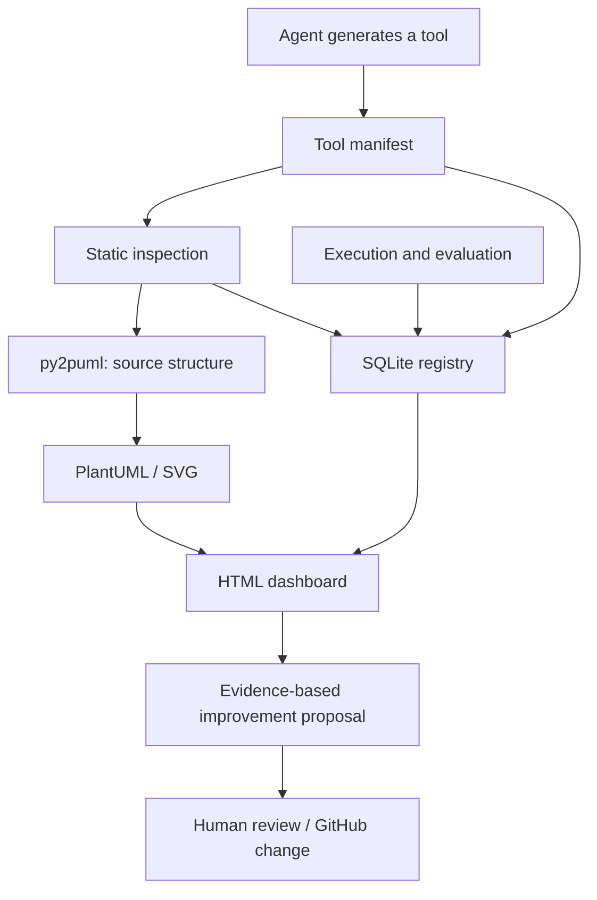

# Agent Tool Registry — Design Proposal

## Purpose

Treat tools generated by Software Factory agents as managed factory assets rather than disposable outputs. The registry should structure, present, and retain tool metadata, source structure, provenance, dependencies, and evaluation history.

This repository's `py2puml` can provide Python source inspection and PlantUML class-diagram generation. The registry is a thin layer around it; it should not turn `py2puml` itself into a database or dashboard.

## Flow



## Responsibilities

- **Manifest (YAML):** stable identity, purpose, interface, entrypoint, runtime, dependencies, permissions, provenance, and artifact references.
- **Python inspector:** read source metadata and optionally invoke `py2puml`; do not execute newly generated code during registration.
- **PlantUML renderer:** convert `.puml` to SVG as a derived artifact.
- **SQLite:** searchable current registry and queryable history.
- **JSONL events:** append-only interchange/audit stream for registration, execution, evaluation, and status changes.
- **HTML dashboard:** search/filter tools, inspect details and provenance, show SVG diagrams and evaluation history.
- **GitHub:** source of truth for code and reviewed configuration changes.

## Initial manifest sketch

```yaml
schema_version: "1"
tool:
  id: "tool.<domain>.<name>"
  name: "Example Tool"
  description: "What problem this tool solves"
  version: "0.1.0"
  status: "generated" # generated | evaluated | approved | deprecated
source:
  repository: "owner/repository"
  path: "src/example_tool"
  commit: null
runtime:
  language: "python"
  entrypoint: null
  interface: "cli" # cli | mcp | http | library | workflow
contract:
  inputs: []
  outputs: []
  permissions: []
provenance:
  agent_id: null
  issue_url: null
  model: null
  prompt_ref: null
artifacts:
  plantuml: null
  svg: null
evaluation:
  status: "not_evaluated"
  latest_run_id: null
```

The example is a proposal, not a committed schema contract. Keep credentials and secret values out of manifests and the database.

## Initial database entities

| Entity | Purpose |
|---|---|
| `tools` | Current identity, description, source location, version, status |
| `provenance` | Agent, Issue, commit, prompt/model references |
| `contracts` | Input/output schema and declared permissions |
| `dependencies` | Relationships between tools |
| `evaluations` | Test outcome, latency, token usage, estimated cost, evidence reference |
| `artifacts` | PlantUML, SVG, reports, checksums and locations |
| `events` | Registration, execution, evaluation, and lifecycle events |

Use JSONL as the portable event log and SQLite as the query/index layer. Avoid duplicating full source files in the database; store repository paths and immutable commit references instead.

## Dashboard views

1. **Catalog:** tool name, purpose, language, interface, lifecycle status, version, latest evaluation.
2. **Tool detail:** manifest, source links, provenance, input/output contract, dependencies, history.
3. **Structure:** generated PlantUML/SVG class diagram and dependency graph.
4. **Factory metrics:** generated count, reuse, pass rate, failures, latency, token usage, estimated cost.
5. **Improvement candidates:** untested tools, repeated failures, likely duplicates, stale versions.

## Safety and governance

- Registration should prefer static inspection; never automatically execute unknown generated code.
- Separate existence, test pass, approval, and security review. A generated tool is not trusted merely because it was cataloged.
- Agents may register observations and propose improvements. They must not silently change canonical policies, permissions, or their own authority.
- Changes to canonical configuration should go through a branch/PR, validation, review, and explicit human approval.
- Do not store secrets or duplicate sensitive runtime data in manifests, logs, or the registry.

## Implementation sequence

1. Agree on the manifest schema and lifecycle states.
2. Implement a minimal CLI to validate and register a manifest.
3. Inspect Python sources and generate `.puml` with `py2puml`; render SVG as a derived artifact.
4. Store metadata and evaluation events in SQLite, with JSONL export/import.
5. Build a small HTML catalog and tool-detail view.
6. Add tests for identity, schema validation, provenance, and dashboard data.
7. Add evidence-based suggestions only after the registry has reliable evaluation data.

## Acceptance criteria

- Each tool has a stable ID and traceable version/source commit.
- Source diagrams and registry records are linked by tool ID.
- The database can query tools, dependencies, provenance, and evaluation history.
- The dashboard distinguishes untested tools from evaluated and approved tools.
- Registration does not execute generated code.
- Improvement suggestions cite supporting evidence and do not bypass human approval.
